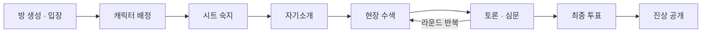

# 🕵️ Alibi

**모두가 용의자, 단 한 명의 범인.**

현장을 수색하고, 서로를 심문하고, 알리바이를 무너뜨리세요. 
실시간 멀티플레이 <b>머더미스터리</b> 웹 게임

🚧 *현재 개발 중입니다* 🚧

---

## 📖 About

**Alibi**는 플레이어 전원이 사건의 등장인물이 되어 범인을 찾아내는 **머더미스터리** 웹 게임입니다.
플레이어는 각자 하나의 캐릭터를 맡고, 그중 단 한 명은 진짜 범인입니다.
모두가 자신의 알리바이를 지키면서, 현장에 남은 단서와 서로의 진술 속 모순을 파고들어 진실에 다가갑니다.

> **머더미스터리(Murder Mystery)란?**
> 참가자들이 각자 캐릭터 시트를 받아 사건 관계자를 연기하며, 단서 수집과 토론을 통해 범인을 밝혀내는 롤플레잉 추리 게임 장르입니다.
> 일반적인 추리 게임과 달리 **범인도 플레이어 중 한 명**이며, 모든 플레이어가 저마다의 비밀과 목적을 가지고 있습니다.

- 🎭 **모두가 용의자** — 플레이어마다 행적과 숨기고 싶은 비밀이 담긴 캐릭터 시트가 주어집니다.
- 🔍 **직접 수색하는 현장** — 장소를 골라 단서를 찾고, 어떤 단서를 공개할지는 스스로 결정합니다.
- 🗣️ **진술과 심문** — 토론 시간에 알리바이를 주장하고, 다른 플레이어의 거짓말을 추궁합니다.
- 🎯 **나만의 개인 미션** — 범인 찾기와 별개로, 캐릭터마다 몰래 달성해야 할 목표가 있습니다.
- 🗳️ **최종 투표와 진상 공개** — 범인을 지목하면 사건의 전말과 모든 캐릭터의 진실이 드러납니다.
- 🗂️ **다양한 내장 시나리오** — 서로 다른 배경과 인원, 난이도의 사건이 계속 추가됩니다.

## 🎮 How to Play

1. 시나리오를 골라 방을 만들고 친구들을 초대합니다.
2. 각자 캐릭터 시트를 받아 자신의 행적과 비밀, 개인 미션을 확인합니다.
3. 현장을 수색해 단서를 모으고, 토론을 통해 서로의 알리바이를 검증합니다.
4. 최종 투표로 범인을 지목하면, 사건의 진상과 최종 점수가 공개됩니다.

## 📦 Repositories

| Repository | Description |
|---|---|
| `frontend` 🔒 | 웹 클라이언트 |
| `backend` 🔒 | 게임 서버 |

> 소스 코드는 현재 비공개로 개발 중입니다.

## 🛠 Tech Stack

> 기술 스택은 확정되는 대로 업데이트됩니다.

---

*진실은 단서 속에, 거짓은 알리바이 속에.*

